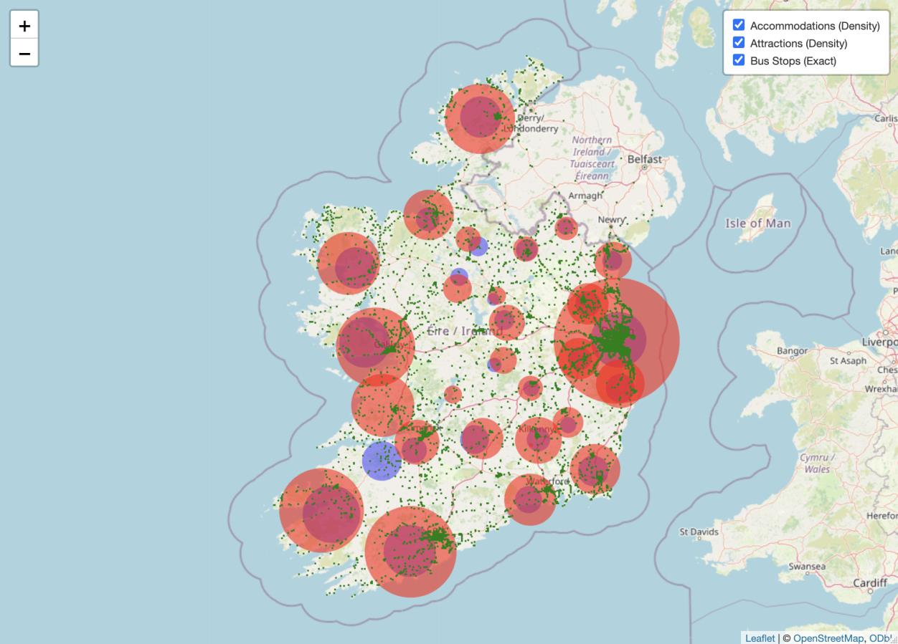
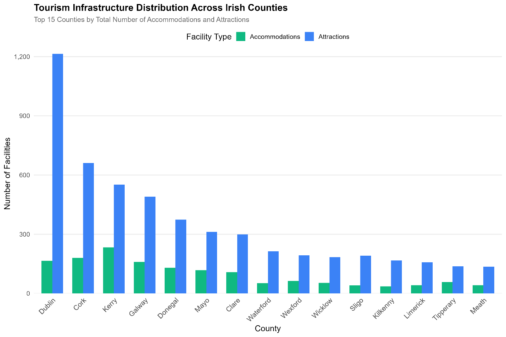
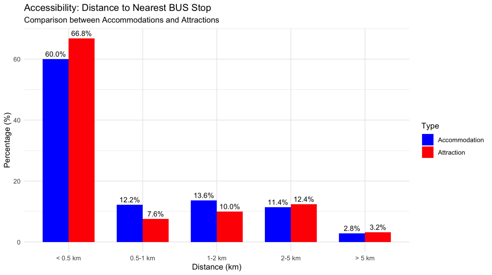
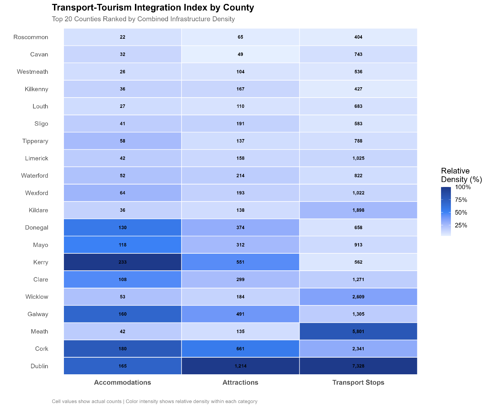
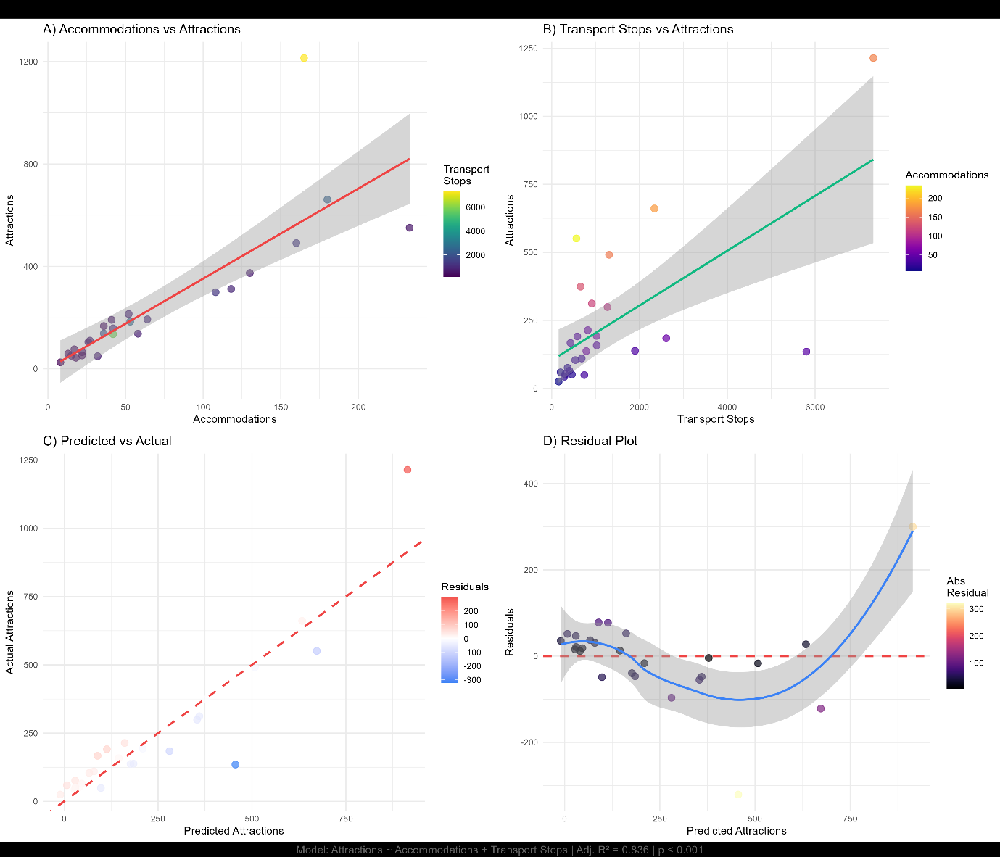

# Tourism and Public Transport Accessibility in Ireland: A Spatial Analysis

How are tourist accommodation and attractions spread across Irish counties, and how easy are they to reach by public transport? This project combines three national open datasets in R to answer that, using data cleaning, geospatial distance analysis, interactive maps and regression modelling.

*Group project for Applied Data Wrangling & Visualisation (POL42540), University College Dublin, 2025.*



## Research questions
1. How are tourist attractions and registered accommodation distributed across Irish counties?
2. How close are they to public transport stops?

## Data
Three official open datasets from [data.gov.ie](https://data.gov.ie):

| Dataset | Source | Records |
|---|---|---|
| [Tourism Activities and Attractions](https://data.gov.ie/dataset/tourism-activities-and-attractions) | Fáilte Ireland | ~6,080 |
| [National Quality Assurance Framework: Register of Accommodation](https://data.gov.ie/dataset/national-quality-assurance-framework-register-of-accommodation) | Fáilte Ireland | ~2,300 |
| [National Public Transport Access Nodes (NaPTAN)](https://data.gov.ie/dataset/national-public-transport-access-nodes-naptan) | National Transport Authority | ~19,100 |

The raw CSVs aren't included in this repo. Download them from the links above.

## Key findings
- **Tourism is heavily concentrated.** Dublin, Cork, Kerry and Galway dominate, and many midland counties have far less tourism infrastructure.
- **Accommodation and attractions cluster together.** Strong positive correlation at county level: Pearson **r = 0.832**, p < 0.001 (Spearman ρ = 0.847).
- **Transport adds explanatory power.** A multiple regression using accommodation count plus transport stops explains **71.8%** of the variation in attractions (adjusted R² = 0.718, p < 0.001) and beats the accommodation-only model (ANOVA).
- **There's an accessibility gap.** 66.8% of attractions are within 500 m of a bus stop, compared with 60.0% of accommodation. More accommodation sits 0.5–2 km from the nearest stop, which suggests a "last kilometre" gap for tourists getting back to where they're staying.

## Methods
- **Cleaning:** converted types, standardised county names, removed missing or out-of-bounds coordinates (outside Ireland), and filtered transport stops to active bus stops and stations
- **Proximity analysis:** Haversine distance from each accommodation and attraction to its nearest bus stop, grouped into distance bands
- **Statistics:** Pearson and Spearman correlation; three linear regression models compared with R², adjusted R², AIC and ANOVA; residual diagnostics
- **Visualisation:** ggplot2 charts, a heatmap, and interactive Leaflet maps (density bubbles, point layers and heatmaps)

## Figures
| | |
|---|---|
|  |  |
|  |  |

## Repository structure
```
scripts/
  statistical_analysis.R   # cleaning, descriptive stats, correlation, regression, ggplot figures
  maps_and_proximity.R     # Leaflet maps, bus-only proximity analysis, county ratios
figures/                   # key figures from the final report
```

## Tools
R: tidyverse (dplyr, ggplot2, readr), geosphere, leaflet, leaflet.extras, tidygeocoder, viridis, ggrepel, gridExtra

## Team and my role
Team: Aayush Pradip Rokade, Balachandaran Saravanan, Raghu Rakesh S, Yukthi Kedarnatha Mathad

**My contribution:** I led the analysis. I cleaned all three datasets, ran the Pearson correlation, built and compared the three regression models, implemented the Haversine proximity calculations, and produced the graphs. I also wrote the statistics section of the report.

## Limitations
Accessibility is measured as straight-line distance to the nearest stop. It doesn't account for service frequency, reliability or travel time.
